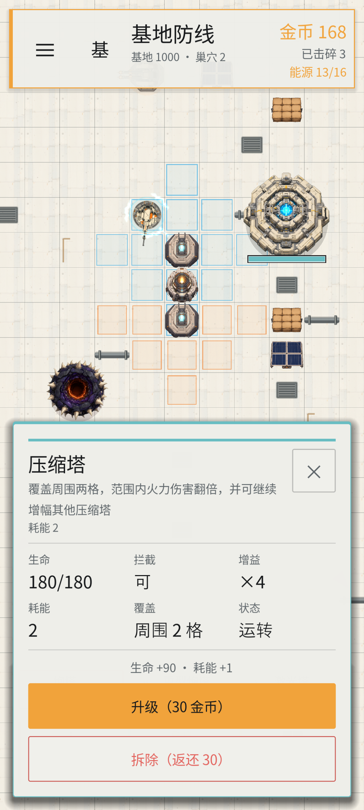

# 构筑枪械 Build Shoot

## 核心玩法

玩家守护位于无限地图中央的基地。四个巢穴从不同方向持续生成怪物，怪物会主动接近基地，并攻击途中的围墙、强化塔等拦截建筑。炮塔会自动攻击射程内最近的怪物或巢穴。

- 开局有 5 秒准备时间和 150 金币；准备期内巢穴不生成怪物，炮塔不开火。
- 基地初始生命 1000，生命归零时失败。
- 巢穴拥有独立生命、生成间隔、怪物类型和摧毁奖励。
- 所有巢穴被摧毁且场上怪物清空后胜利。
- 金币来自击碎怪物和摧毁巢穴，可用于建造与升级。
- 基地和巢穴占据的格子不能建造；巢穴摧毁后释放其格子。
- 怪物与基地/阵地使用按可见尺寸计算的圆形接触范围，斜向接近时不会被矩形角部提前挡在空地外。


初始 150 金币可以建造发电塔（40）和炮塔（30），并保留 80 金币用于后续构筑。建筑系统保留三类：

- **火力**：炮塔、重型炮塔、激光炮。自动攻击怪物和巢穴。
- **阵地**：围墙、强化塔。围墙负责拦截，并与上下左右相邻围墙自动连接；强化塔为周围两格提供伤害增益。
- **能源**：发电塔提供 4 点能源；金币塔持续产出金币；两座超级建筑提供 60 和 120 点能源。

非能源建筑需要供电。产能不足时按建造顺序供电，后建造的建筑离线并置灰；补充能源后自动恢复。

## 无限地图与镜头

地图以基地 `[0, 0]` 为世界原点，64×64px 格子可向正负方向无限延伸。游戏只生成镜头附近的地面，不为无限地图分配无限节点或内存。

- 空地拖动：移动镜头。
- 鼠标滚轮／双指缩放：调整视野。
- WASD／方向键：移动镜头。
- Home：回到基地。
- 屏外巢穴：显示粉色方向指示。
- 商店拖拽和建筑范围预览优先，不会触发镜头移动。

战场不再缩放到一整张固定矩形内，炮弹也不再碰到场地墙面反弹。

## 操作

| 操作 | 键鼠 | 触摸 |
| --- | --- | --- |
| 选择类别/道具 | 点击底部类别标签切换道具列表 | 同左 |
| 布置建筑 | 从底部道具卡拖到格子，松手直接放置 | 同左 |
| 取消拖拽 | 将道具拖回底部 UI 或资源区，松手取消 | 同左 |
| 移动镜头 | 拖动空地、WASD 或方向键 | 单指拖动空地 |
| 缩放 | 鼠标滚轮 | 双指缩放 |
| 回到基地 | Home | — |
| 查看/升级/拆除 | 点击已放置建筑 | 同左 |
| 系统设置/暂停 | Esc 或右上角 ≡ | 右上角 ≡ |
| 切换语言 | L 或设置面板 | 设置面板 |
| 重开 | R、设置面板或结算面板 | 设置面板或结算面板 |

## 建筑与升级

| 建筑 | 类别 | 造价 | 能源 | 生命 | 作用 |
| --- | --- | --- | --- | --- | --- |
| 炮塔 | 火力 | 30 | 耗能 1 | 50 | 圆形射程自动索敌 |
| 重型炮塔 | 火力 | 120 | 耗能 2 | 80 | 慢速重弹，按威力连续贯穿 |
| 激光炮 | 火力 | 150 | 耗能 3 | 70 | 持续光束，直接伤害单体 |
| 闪电炮 | 火力 | 110 | 耗能 2 | 65 | 蜿蜒闪电在一格内扩散，最多命中 4 个目标 |
| 围墙 | 阵地 | 15 | 无需耗能 | 120 | 拦截怪物并吸收攻击 |
| 强化塔 | 阵地 | 60 | 耗能 2 | 180 | 周围两格内火力伤害 ×2 |
| 发电塔 | 能源 | 40 | 产能 +4 | 80 | 更高产能 |
| 金币塔 | 能源 | 40 | 耗能 1 | 70 | 每 4 秒产出 5 金币，升级提高产出 |
| 超级聚能塔 | 能源 | 2000 | 产能 +60 | 180 | 需 1000 金币研发，是原太阳能产能的 30 倍 |
| 超级发电塔 | 能源 | 2000 | 产能 +120 | 240 | 需 1000 金币研发，是发电塔产能的 30 倍 |

- 炮塔升级：攻击 +5、耗能 +1；重型炮塔：攻击 +30、耗能 +2；激光炮：攻击和耗能 ×2。
- 阵地升级提高生命；能源升级提高产能，金币塔提高每轮金币产出。升级费用随等级递增。
- 怪物击杀金币调整为原生命值的 35%（至少 1 金币），金币塔提供持续经济。
- 拆除返还总投入的 50%；未供电建筑或拆除后将没有火力时全额返还。
- 强化塔覆盖自身周围两格，放置时不需要选择朝向；同种强化塔也按 ×2 乘算，不同种攻击光环同样叠乘。
- 同一连通网络中的强化塔共享总倍率：每增加一座在线强化塔，网络倍率再 ×2，所有成员及受益炮塔都使用同一个结果；2、3、4 座相连时分别为 ×2、×4、×8。独立网络之间正常乘算，不设上限，也不受建造顺序或受益炮塔数量影响。
- 建筑保留基础攻击与有效攻击：建造、升级、拆除和供电变化时重算，炮弹、激光和聚焦面板统一读取有效攻击；受增益的火力数值以“基础值 → 有效值”高亮显示，强化塔面板显示当前实际输出倍率。
- 生效的增益关系会显示青色能量链，方向从增益来源指向目标；链路由 MultiMeshInstance2D 合批，发光能量包通过 shader 持续向目标流动，断电或拆除后消失。链路绘制在建筑上方、命中特效下方，不再被建筑遮住。
- 受强化的火力建筑周围显示旋转分段电弧，替代原来的上升粒子；×2、×4、×8、×16 分别对应 2、3、4、5 段，倍率继续增长时最多显示 12 段，仅限制视觉数量，不限制伤害。
- 射程和施法范围按格子计算，显示与实际索敌使用同一组格子。

### 研发解锁

- 强化塔、激光炮、闪电炮分别需要 300、300、400 金币研发。
- 超级聚能塔和超级发电塔各需 1000 金币研发，研发后还需支付 2000 金币部署。
- 未研发卡片会显示研发价格，点击卡片完成研发；研发前不能拖拽部署。
- 研发状态由事件中心同步，并在每局开始时重置。

### 放置与范围高亮

- 绿色：镜头内当前可放置的格子。
- 红色：基地、巢穴、已占用建筑等非法位置。
- 青色：火力射程和当前强化塔自身范围。
- 橙色：与当前强化塔相连的其他增益塔所新增的范围；与本塔重叠的格子仍保留青色。
- 高亮位于瓦片上方、怪物和建筑下方。




## 主界面与设置

- F5 先进入主界面，可开始行动、打开设置或退出。
- 游戏内 Esc 或右上角 `≡` 打开系统面板并暂停。
- 设置包含中英文、全屏、怪物动画、场地网格、索敌提示，以及独立的音效和背景音乐开关。
- 设置保存到 `user://settings.cfg`；无头测试不会读写用户配置。
- 中文使用内置 Noto Sans SC 子集。修改 `i18n/*.json` 后运行 `python tools/build_font_subset.py` 并重新导入资源。

## 音频

游戏包含 13 个原创程序化短音效：界面点击、建造、升级、非法操作、普通射击、重炮、激光、命中、击碎、增益、基地受击、胜利和失败。另有 `menu_loop.wav` 工业氛围主界面音乐和 `battle_loop.wav` 电子战斗音乐，两首均为约 32 秒的无缝循环。

音频源文件为 44.1kHz 单声道 16-bit PCM WAV，Godot 导入时使用 QOA 压缩。全局 `Sfx` 使用 12 路播放器池。射击和命中等高频事件带冷却及轻微音高变化；池满时普通事件丢弃，基地受击和胜负事件可抢占较旧的低优先级声音。

全局 `Music` 使用双播放器交叉淡化，主界面和战斗场景自动切换曲目。音效与音乐开关在设置中分别即时生效并保存。

重新生成全部 WAV：

```bash
python tools/generate_sfx.py
python tools/generate_music.py
Godot_v4.7.2-stable_win64_console.exe --headless --path . --import
```

生成脚本仅使用 Python 标准库，固定随机种子，重复运行会逐字节生成相同文件。

## 运行

- Godot 4.7，移动渲染器，设计视口 960×540，横屏。
- 桌面默认窗口 1280×720；16:10 与超宽屏扩展可视空间，移动端适配安全区。
- 战斗 UI 使用精简顶部资源栏、底部标签式建造栏和横向建筑详情；设置项采用双列布局。
- 编辑器打开项目后 F5，或运行：

```bash
Godot_v4.7.2-stable_win64.exe --path .
```

- Web 导出：`.\tools\build_web.ps1`。

## 在线游玩与部署

- 在线地址：https://soryu-ryouji.github.io/build-shoot/
- 推送 `2d` 分支或在 Actions 中手动运行 **Deploy to GitHub Pages**，会自动导出 Web 版并部署。
- 工作流使用 Godot 4.7.2 和对应导出模板，产物包含 `web/index.html` 横屏入口页。

## JSON 无限地图

只有一个 `scenes/main.tscn`。启动时 `scripts/arena.gd` 加载 `data/maps/industrial_01.json`，`scripts/map_loader.gd` 生成镜头附近的 Ground 和 Decoration 瓦片。

当前地图格式为 `version: 2`：

```json
{
  "version": 2,
  "id": "industrial_01",
  "tileset": "res://assets/tilesets/industrial.tres",
  "palette": {
	"floor_a": { "source": 0, "atlas": [0, 0] }
  },
  "generation": {
	"seed": 41027,
	"ground_tiles": ["floor_a"]
  },
  "base": {
	"cell": [0, 0],
	"size": [3, 3],
	"hp": 1000
  },
  "nests": [
	{
	  "cell": [-5, -4],
	  "hp": 45,
	  "spawn_interval": 7.0,
	  "kind": "normal",
	  "reward": 30
	}
  ]
}
```

新增地图只需复制 JSON，调整种子、地面、基地和巢穴，不需要新增场景或修改战斗代码。同一坐标在同一 seed 下始终生成相同地面。

详细结构见 [地图系统改造文档](docs/map_system_refactor_proposal.md)。导出预设包含 `data/maps/*.json`。

## UI 预置体与事件驱动

HUD、底部建造栏、道具卡、建筑详情、设置和结算均位于 `scenes/ui/`，可在 Godot 编辑器中直接调整。主菜单的完整节点树位于 `scenes/main_menu.tscn`。

`Events` 自动加载提供状态缓存和具体事件；UI 使用 `EventBinding` 统一绑定、去重和解绑。详细目录、事件列表与扩展示例见 [UI 预置体与事件中心](docs/ui_prefabs_and_events.md)。

## Save system

- Autosaves every 15 seconds, saves from the in-game settings, and saves when returning to the menu.
- The main menu provides Continue and Delete Save. Deletion requires a second click within three seconds.
- `user://savegame.json` stores coins, research, buildings and levels, production timers, base/nest health, enemies, camera, and wall connections.
- Saves are versioned; malformed or incompatible saves are rejected without being overwritten.

## 测试

```bash
Godot_v4.7.2-stable_win64_console.exe --headless --fixed-fps 60 --path . res://tools/smoke_test.tscn
Godot_v4.7.2-stable_win64_console.exe --headless --fixed-fps 60 --path . res://tools/responsive_test.tscn
Godot_v4.7.2-stable_win64_console.exe --headless --fixed-fps 60 --path . res://tools/event_center_test.tscn
Godot_v4.7.2-stable_win64_console.exe --headless --fixed-fps 60 --path . res://tools/save_test.tscn
Godot_v4.7.2-stable_win64_console.exe --headless --fixed-fps 60 --path . res://tools/stress_test.tscn -- --enemies=1000 --seconds=10
```

冒烟测试覆盖：无限正负坐标、远距离地面加载、基地/巢穴占用、放置与拆除、能源和升级、炮塔/激光/炮弹攻击巢穴、巢穴独立生成、怪物向基地移动、阵地拦截、同种光环乘算、异种光环叠乘、强化塔两格圆形范围、免朝向放置、A3/A2 双塔与后放 A4/A5 扩展、双炮塔共享网络、公共增幅去重、无上限增长与互相覆盖、能量链方向/层级、本塔与网络双色范围、环绕电弧数量与断电生命周期、拆除恢复、有效攻击面板、音效加载与限频开关、音乐加载与场景切换、镜头移动缩放、清场胜利、基地失败和第二 JSON 校验。

响应式测试覆盖 960×540、1280×720、1920×1080、1440×900、1920×800、844×390，以及 HUD、商店、触摸部署、设置面板、主界面和镜头坐标转换。

压力测试固定生成 1000 只高生命怪物、16 座火力塔和充足供电，保留巢穴与基地战斗，预热 1 秒后采样 10 秒。输出敌人数量、节点数、draw call、帧时间和实测 FPS，不设置跨硬件通用的帧率门槛。无头结果只代表逻辑吞吐；去掉 `--headless` 可在目标设备上测量真实 2D 渲染。

千怪路径使用 64px 稀疏空间哈希处理索敌、炮弹和阵地查询，炮塔每 0.12 秒错帧刷新目标，完整瞄准预测仅给选中建筑绘制。怪物本体按类型使用 MultiMeshInstance2D 合批，动画、阴影、光圈、受击和攻击效果在 shader 内完成，父节点只绘制受伤后限时显示的血条。命中火花、金币和中心闪光也分别使用 MultiMeshInstance2D 合批。

## 更新截图

```bash
Godot_v4.7.2-stable_win64_console.exe --path . res://tools/screenshot.tscn
Godot_v4.7.2-stable_win64_console.exe --path . res://tools/screenshot.tscn -- --place
Godot_v4.7.2-stable_win64_console.exe --path . res://tools/screenshot.tscn -- --orient
Godot_v4.7.2-stable_win64_console.exe --path . res://tools/screenshot.tscn -- --buff
```

默认生成 `image.png`；附加 `--settings`、`--focus`、`--power` 可生成对应状态，`--size=1280x720` 可指定尺寸，`--locale=en` 可检查英文排版。

## 美术素材

主界面、怪物、建筑、工业地面、基地和巢穴素材由本地 ComfyUI 生成。基地与巢穴使用绿幕出图并抠像：

```bash
python tools/generate_defense_art.py
python tools/process_defense_art.py
```

工业地面与 TileSet 重建：

```bash
python tools/generate_map_art.py
python tools/process_map_tiles.py
Godot_v4.7.2-stable_win64_console.exe --headless --path . --import
Godot_v4.7.2-stable_win64_console.exe --headless --path . -s res://tools/build_tileset.gd
```

后处理需要 Pillow；系统环境不可用时可在项目 `.venv` 中安装。其他 UI 素材仍使用 `tools/generate_ui_assets.py` 和 `tools/process_ui_assets.py`，提示词记录见 [ART_PROMPTS.md](ART_PROMPTS.md)。

## 文件结构

```text
scenes/main.tscn            唯一战斗场景
data/maps/                  version 2 无限地图 JSON
assets/tilesets/            工业瓦片与 TileSet
assets/ui/base_core.png     中央基地
assets/ui/nest.png          怪物巢穴
assets/audio/sfx/           13 个原创 WAV 音效
assets/audio/music/         主界面与战斗循环音乐
scripts/audio_manager.gd    全局音效池、限频、优先级和按钮点击
scripts/music_manager.gd    循环音乐、场景切换与交叉淡化
scripts/main.gd             游戏状态、镜头、放置、能源与胜负
scripts/building_buffs.gd   建筑光环、叠乘组和有效攻击缓存
scripts/energy_links.gd     增益关系链路与定向流动 shader
scripts/buff_electricity.gd  随倍率增长的建筑环绕电弧
scripts/enemy_spatial_index.gd 无限地图敌人空间哈希
scripts/map_loader.gd       稀疏坐标、局部地面和占用
scripts/base_core.gd        基地生命与受击
scripts/nest.gd             巢穴生命、生成计时与摧毁
scripts/blocks.gd           敌人生成、基地导向移动、空间索引与 MultiMesh2D 绘制
scripts/ball.gd             无限地图炮弹与局部敌人/巢穴碰撞
scripts/hit_effects.gd      火花、金币与闪光的 MultiMesh2D 合批
scripts/placed_building.gd  建筑行为、升级、拦截和攻击
scripts/tile_highlights.gd  放置与范围高亮
scripts/hud.gd              基地状态、能源和屏外巢穴指示
tools/smoke_test.gd         玩法冒烟测试
tools/stress_test.gd        1000 怪物与 16 火力塔压力测试
tools/responsive_test.gd    多分辨率与操作测试
tools/screenshot.gd         战斗状态截图
tools/generate_sfx.py       可重复生成全部原创 WAV 音效
tools/generate_music.py     可重复生成两首循环背景音乐
```
