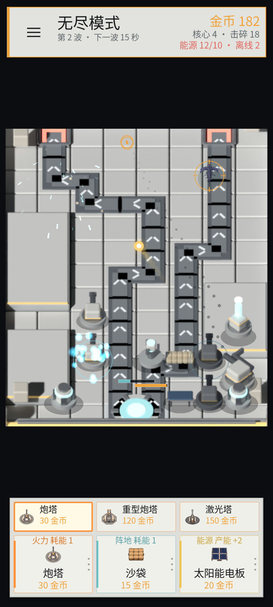
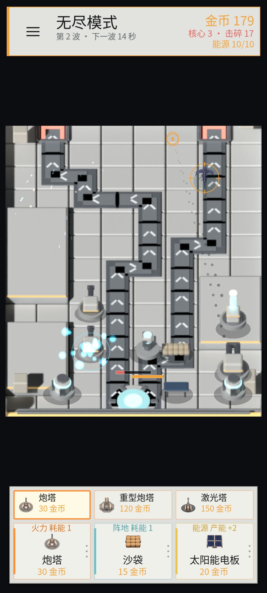
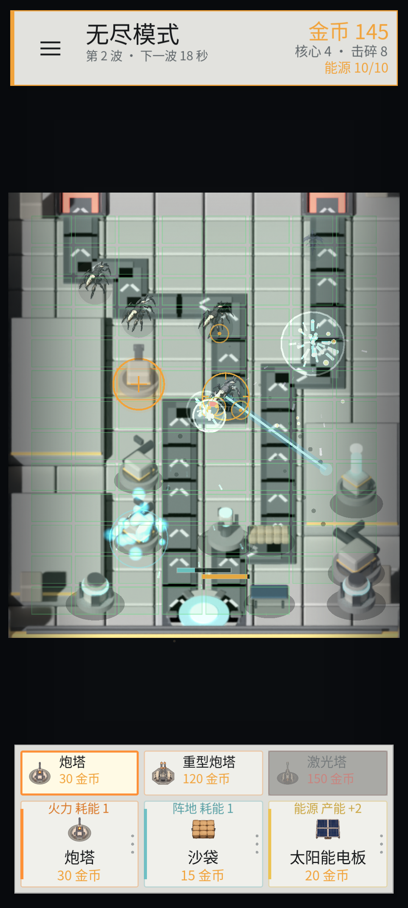
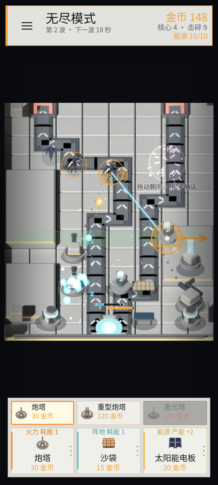
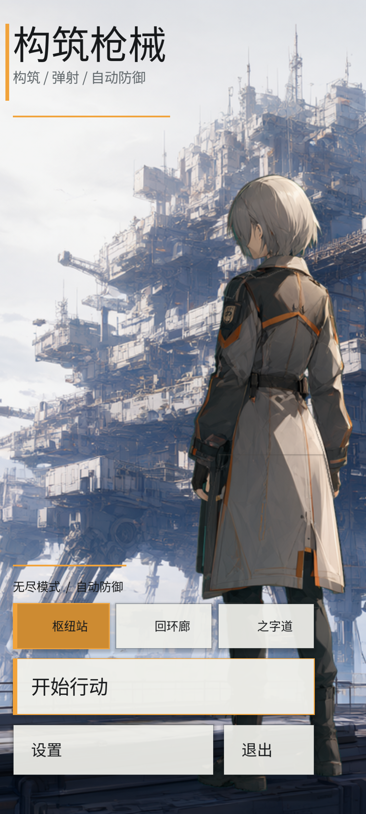
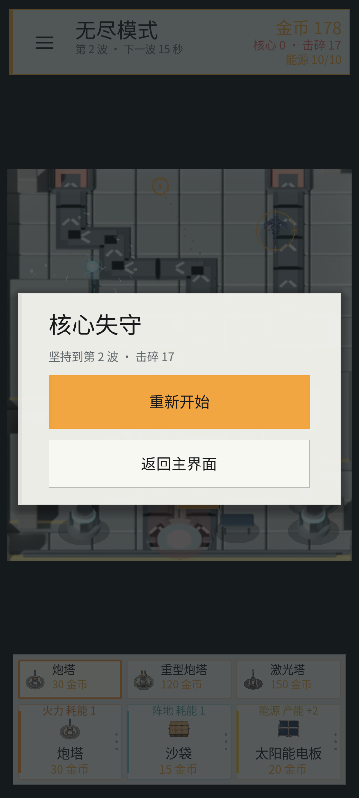
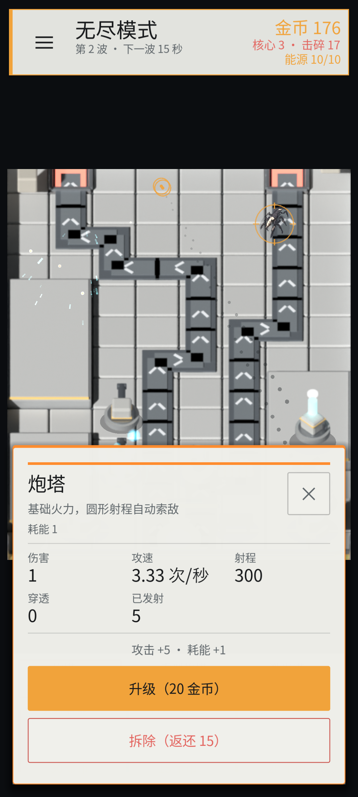
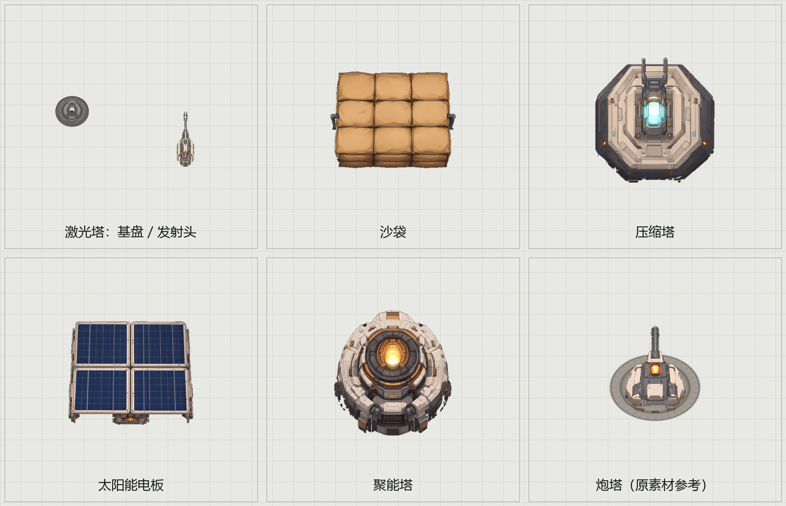

# 构筑枪械 Build Shoot

## 核心玩法

三张 8×13 格子的 2.5D 地图可轮换：地形和场上建筑都是 Blender 正交渲染的贴图（俯角约 45°），每张有自己的缺口位置、路线走向和核心位置，主界面可以切换。敌人从缺口出场，沿画在地面上的通路走向核心；把它们拦在路上或打掉，核心血量归零就失败。

开局有 5 秒准备时间和 50 金币，玩家先把太阳能电板和炮塔放到格子上。倒计时结束后敌人开始从缺口涌出，炮塔自动锁定并射出弹珠。

金币来自击碎敌人。商店按三类切换道具列表，所有形态都直接建造；部署后还可以在聚焦面板里按等级升级，低/中/高级建筑用不同成长曲线：

- **火力**：炮塔、重型炮塔、激光塔。拖到格子后直接放置，射程用绿色格子显示。
- **阵地**：沙袋、压缩塔。沙袋负责拦截；压缩塔有施法朝向，需要二次确认，施法范围用绿色格子显示。
- **能源**：太阳能电板、聚能塔。产能分别为 2 和 4。

部署限制按明日方舟的规则：**阵地建筑可以压在通路上当阻挡位，火力和能源只能放在路外**，缺口和核心所在格子谁都不能建。拖到通路上时放置预览会直接判红，松手提示「通路上只能放阵地建筑」。

所有非能源建筑都要消耗能源。总产能小于总耗能时，按布置顺序供电，既有建筑优先；新布置且排不进供能的建筑离线：炮塔停火、压缩塔失效、沙袋不再拦截，建筑图标同时置灰。能源不足不再弹出提示，右上角只保留能源供需读数；补上能源建筑后，离线的建筑会按布置顺序恢复。



初始 50 金币刚好是太阳能电板（20）+ 炮塔（30）。如果先放炮塔，炮塔图标会因缺电置灰，放下太阳能电板后立刻恢复；之后新增建筑如果超出产能，只有新建筑置灰离线，已经运转的建筑不会被拖停。

游戏界面如下图：地图上灰色带箭头的路面是敌人的行进路线，深色门洞是出怪口，青色装置是核心；核心血量归零即失败。底部上方是当前类别的道具列表、下方是火力/阵地/能源三类卡；顶栏右上角一列右对齐显示金币、核心血量与击碎数、能源供需，左侧显示当前波次和下一波倒计时。



## 当前版本

已跑通的玩法闭环：

- 开局没有默认建筑，玩家有 50 金币；5 秒准备期内不出怪
- 地图固定为 8×13 瓦片（每格 48×34 像素，2.5D 投影），共三张：枢纽站（顶部两个缺口汇入中央核心）、回环廊（左右两侧缺口对称收束）、之字道（长折返路线通往右下核心）；主界面点地图名切换，选择会保存
- 地形分高低两层：`high` 矩形标出的高台比低地高一层，边缘有侧壁和橙色压条；高台上的建筑会按同样的投影高度往上抬，看起来是站在平台上
- 缺口和核心所在格子不能建造；通路上只能放阵地建筑，火力和能源必须放在路外
- 敌人从缺口淡入后沿路线逐格行走，被沙袋等阵地建筑挡住时停下攻击，撞到核心扣 1 点核心血量
- 核心 12 点血量，扣完弹出结算面板（坚持到第几波、击碎多少），可以直接重开或回主菜单
- 底部商店固定三张类别卡：火力、阵地、能源；点击类别切换其道具列表，选中道具后类别卡会显示该道具；金币不足时道具项和类别卡都变灰，道具项仍可点击切换
- 火力：炮塔基础伤害 1、攻速 3.3 次/秒、射程 300；重型炮塔伤害 10、攻速 0.5 次/秒、射程 500，按威力连续贯穿；激光塔持续光束直接灼烧目标，伤害 5/0.2 秒
- 火力建筑为 360° 圆形射程，按绿色格子判定目标；拖到格子后直接放置，不需要二次确认，之后自动锁定射程格子内的目标
- 重型炮塔 120 金币、激光塔 150 金币，和炮塔并列出现在火力道具列表中，直接建造
- 阵地：沙袋生命 120，敌人接触后停下攻击沙袋，沙袋被摧毁后敌人继续前进；压缩塔 60 金币，生命 180
- 压缩塔：拖放到格子后需要二次确认，绿色格子会标出施法直线；确认后绿格隐藏，不再画线，被加成的火力塔身上会持续冒青色粒子，多个压缩塔不叠加
- 能源：太阳能电板产能 2、20 金币；聚能塔产能 4、60 金币。总产能不足时只有排在后段或新布置的建筑离线并置灰
- 建筑部署后可升级：炮塔每级攻击 +5、耗能 +1；重型炮塔每级攻击 +30、耗能 +2；激光塔每级攻击 ×2、耗能 ×2，上限更高；沙袋/压缩塔加生命，能源建筑加产能
- 每次发射都会生成一颗独立的球，之前发射的球继续飞行；基础炮弹撞到第一个敌人或墙面就消失
- 每颗球独立计算寿命，撞墙或命中后消失
- 敌人被击中/击碎时会溅出对应颜色的火花和闪光，电击命中使用蓝白火花；击碎时额外爆出金币碎屑
- 击碎敌人按最大血量获得金币，顶部 HUD 显示金币数
- 开局准备结束后先出 3 只；约 12 秒后第二波开始，每波 3~5 批、总量 27~40 只，从两个缺口交替出场
- 每波先爆发再留出清场时间：第 2~3 波间隔 27 秒，第 4~5 波 30 秒，第 6 波起 33 秒，形成松紧交替的节奏
- 一波分 1~5 批：第 1 波 1 批 3 只，第 2~3 波 3 批，第 4~5 波 4 批，第 6 波起 5 批，每批最多 11 只
- 同一波里相邻两只敌人间隔 0.55 秒出场，两个缺口轮流使用，所以敌人是成串走上路线而不是同时刷一整排
- 敌人走完全程约 12~15 秒（视移动速度而定），两条路线长度一致
- 怪物分为普通、迅捷、装甲、精英四类，分别在第 1/2/3/4 波解锁；迅捷移动更快，装甲与精英拥有更高血量，并有各自的外观标记
- 普通怪基础血量从 3 开始，每波按 1.28 倍复利增长；血条只在受击后显示 3 秒，重复受击刷新倒计时
- 点击已放置的建筑打开聚焦面板：火力显示伤害/攻速/射程/穿透/发射数；阵地显示生命、拦截、增益、耗能与状态；能源显示产能、生命、净产能与状态
- 聚焦面板显示属性、升级效果与拆除；升级会提高等级并计入投入，拆除返还总投入的 50%，未供电的建筑或拆掉后场上没有火力时全额返还
- 核心血量归零判负；重开按 R

### 操作

| 操作 | 键鼠 | 触摸 |
| --- | --- | --- |
| 选择类别/道具 | 点击类别卡、再点上方道具项 | 点击类别卡、再点上方道具项 |
| 布置建筑 | 从类别卡拖到网格；压缩塔再拖一次选朝向 | 从类别卡拖到网格；压缩塔再拖一次选朝向 |
| 查看/拆除 | 点击已放置的建筑 | 点击已放置的建筑 |
| 系统设置 / 暂停 | Esc 或右上角 ≡ | 右上角 ≡ |
| 切换语言 | L 或设置面板 | 设置面板 |
| 重开 | R 或设置面板 | 设置面板 |

战斗自动进行：火力建筑在圆形射程内自动锁定、转向、开火；玩家负责选道具、拖放、给压缩塔确认朝向、升级建筑和补齐能源。

### 建筑与升级

商店按类别列出全部可建造形态，重型炮塔、激光塔、压缩塔和聚能塔都直接建造；升级不再切换形态，只提高当前建筑的等级、数值和能耗。

| 建筑 | 类别 | 造价 | 能源 | 生命 | 作用 |
| --- | --- | --- | --- | --- | --- |
| 炮塔 | 火力 | 30 金币 | 耗能 1 | 50 | 圆形射程自动索敌，基础弹珠 |
| 重型炮塔 | 火力 | 120 金币 | 耗能 2 | 80 | 慢速重弹，按威力连续贯穿 |
| 激光塔 | 火力 | 150 金币 | 耗能 3 | 70 | 持续光束，直接伤害单体 |
| 沙袋 | 阵地 | 15 金币 | 耗能 1 | 120 | 拦截敌人并吸收攻击 |
| 压缩塔 | 阵地 | 60 金币 | 耗能 2 | 180 | 沿朝向直线覆盖，范围内伤害 ×2 并带电击 |
| 太阳能电板 | 能源 | 20 金币 | 产能 +2 | 50 | 给全场供电 |
| 聚能塔 | 能源 | 60 金币 | 产能 +4 | 80 | 产能翻倍 |

- 能源结算：总产能 ≥ 总耗能时全部正常；不足时按布置顺序给既有建筑供电，只有排在后面的建筑离线并置灰，能源建筑本身继续发电
- 只有压缩塔在拖放后进入二次确认：再拖一次确定 8 个方向之一，松手确认并扣费；炮塔、沙袋、太阳能电板和聚能塔放下即完成
- 升级成长：炮塔攻击 +5/耗能 +1，上限 Lv.5；重型炮塔攻击 +30/耗能 +2，上限 Lv.5；激光塔攻击 ×2/耗能 ×2，上限 Lv.6；沙袋生命 +60/耗能 +1，压缩塔生命 +90/耗能 +1，太阳能电板产能 +1，聚能塔产能 +2
- 升级费用按等级递增，升级投入计入拆除返还；拆除返还总投入的 50%，未供电的建筑或拆掉后场上将没有火力时全额返还，允许玩家把缺电/无输出阵容拆掉重建
- 压缩塔的覆盖范围是穿过自身、沿朝向延伸的整条直线；只有靠近这条直线的火力建筑吃到增益
- 电击弹在命中时使用蓝白火花；激光塔吃到压缩塔增益时伤害同样翻倍
- 敌人只会被阵地建筑拦截，因此沙袋/压缩塔要放在火力前面；被摧毁的阵地会从场上移除
- 拖拽时火力建筑用绿色格子标出圆形射程，压缩塔在二次确认时用绿色格子标出施法直线；确认后绿格隐藏，点击建筑查看详情才再次显示；金币不足时卡片变暗且无法开始拖拽
- 部署期间战场时间降到 28%，屏幕四周压暗，确认或取消后恢复；沉浸感更强，也不会在摆建筑时被怪物偷血
- 射程判定完全按格子，不再画圆弧；预览绿格、选中建筑绿格和索敌范围使用同一套格子
- 点击已放置的建筑打开聚焦面板，显示属性、升级效果和已发射数量；点击空白处或右上角 `×` 关闭





## 主界面与设置

- F5 先进入主界面，可开始行动、打开设置或退出。
- 游戏内按 Esc 或点击右上角 `≡` 打开系统面板，战斗暂停；可继续、重开或返回主界面。
- 设置包含中英文、全屏、怪物动画、场地网格和索敌提示，更改即时生效。
- 设置保存到 `user://settings.cfg`；无头测试不会读取或改写用户配置。
- 主界面使用原创成年女性战术角色，立绘为巨构风格：角色站在观景平台上遥望步行式移动都市；背景和人物分层，人物拆成腿、大衣、躯干、右臂和头五张图，各自绕脚底、髋、颈、肩和衣摆枢轴摆动。战斗场景不加入人形单位，整体采用明亮工业背景、白色面板与信号橙强调色。



## 多语言（i18n）

- 默认语言为简体中文（`zh_CN`），可用 `L` 切换中/英
- 文案全部通过 `I18n.t("key", [参数...])` 读取，代码里不写死显示文本
- 翻译表是扁平的 KEY-VALUE JSON：
  - `i18n/zh_CN.json`（默认）
  - `i18n/en.json`
- 新增语言：复制一份 JSON 翻译好，把语言代码加入 `scripts/i18n.gd` 的 `LOCALES` 即可
- 缺少某个 key 时回退到中文，再回退到 key 本身
- 中文显示使用内置的 Noto Sans SC 子集（`assets/ui/font/`，含 OFL 许可），桌面与 Web 一致，不依赖系统字体
- 新增或修改 i18n 文案后运行 `python tools/build_font_subset.py`：脚本会提取 `i18n/*.json` 的字符，重建 `game_font.otf` 和 `game_numbers.otf`，随后再执行 `--headless --path . --import` 或重新导出 Web

## 运行

- Godot 4.7，移动渲染器，设计视口 400×800（竖屏，1 逻辑像素约等于手机上的 1dp）
- 桌面窗口默认按 480×960 打开，内容按设计视口等比放大；真机全屏时宽度固定 400，长屏向上扩展
- 编辑器打开项目后 F5，或命令行：

```bash
Godot_v4.7.2-stable_win64.exe --path .
```

- 导出 Web 版：`.\tools\build_web.ps1`（产物在 `build\web`，外层 `web/index.html` 负责桌面竖屏舞台）

## 移动端界面尺寸

- 设计视口从 720×960 改为 400×800。之前 13px 的正文在 1080×2400 手机上只有约 5dp，按钮只有约 17dp，按不到也看不清；现在同样的数值直接对应手机上的 dp。
- 可点击控件短边不小于 48（HUD 设置键 52、类别卡 84、道具项 44、聚焦面板按钮 50～58、设置项 56、主菜单 66）；正文 15～17，标题 21～42。
- 底部栏分两层：上方道具列表、下方类别卡；选中道具后拖类别卡到场上，再拖一次选朝向。聚焦面板改为贴底宽面板，拆除按钮落在拇指区；主界面「开始行动」移到底部。
- 建筑点击判定半径从 34 世界单位放宽到 46，并改为选取最近的一座。
- 尺寸基线集中在 `scripts/ui_metrics.gd`，各界面统一引用；回归测试会检查控件短边和正文字号。

## 多分辨率与自适应布局

- 游戏锁定纯竖屏；设计视口为 400×800，使用 `canvas_items` 与 `expand`。
- HUD、主界面和设置使用 Anchors、MarginContainer、HBoxContainer、VBoxContainer 与内容驱动尺寸。
- 商店位于底部，上方是当前类别的道具列表，下方是三类卡；主界面功能菜单位于底部拇指区。移动设备读取安全区域，避开刘海与系统手势区。
- HUD、商店与战场共用 `scripts/responsive_layout.gd` 里的同一组矩形：HUD 高 74、商店高 146，两者合计不到屏幕高度的 28%。
- 战场 Camera 在 HUD 与商店之间的可用区里居中缩放，宽度能放下就贴满宽度，高度不够时再按高度收缩，整张地图始终完整可见，不会被上下栏遮住。
- 地图本身是 8×13 的 48px 瓦片网格（`scripts/battle_map.gd`），路线、缺口、核心与吸附格子都由这一份坐标驱动；窗口变化只改相机缩放，不改地图布局。
- 屏幕／触摸坐标经过 Camera 变换后再用于点击和拖拽部署；主界面背景等比覆盖，不拉伸人物。

响应式回归测试覆盖 720×960、1000×2000、1080×1920、1080×2400，并动态检查战场是否完整落在 HUD 与商店之间、是否用满可用区，以及面板边界、菜单位置、设置面板、触摸拖拽部署与朝向确认、按钮短边和正文字号：

```bash
Godot_v4.7.2-stable_win64.exe --headless --fixed-fps 60 --path . res://tools/responsive_test.tscn
```

## 无头冒烟测试

```bash
Godot_v4.7.2-stable_win64.exe --headless --fixed-fps 60 --path . res://tools/smoke_test.tscn
```

覆盖：默认中文语言包、英文 key 完整性、三类道具列表与直接建造、开局 50 金币、太阳能电板 + 炮塔刚好 50、无默认建筑、开局 5 秒准备/准备期无敌人、敌人从缺口按路线出场、只有压缩塔二次确认、炮塔/电力塔直接放置、部署与确认绿格显示并在放下后隐藏、格子射程判定与圆形覆盖、部署减速/压暗与恢复、建筑等级成长与能耗提升、能源按布置顺序供电、新建筑离线置灰与恢复、重型炮塔/激光塔直接建造、激光塔光束直接伤害、自动索敌开火、沙袋拦截与受击/摧毁后放行、压缩塔朝向直线增益/偏离无效、加成塔粒子开关、电击弹伤害翻倍、瓦片吸附布置/边缘格子/扣费/非法位置、聚焦面板属性与拆除、敌人击碎与金币奖励、命中粒子、波次节奏与血量复利成长、四类怪物差异、核心掉血与失败结算、主界面与设置面板、暂停恢复与设置开关。

## 更新截图

```bash
Godot_v4.7.2-stable_win64.exe --path . res://tools/screenshot.tscn
```

脚本会先快进到第二波，再布置三类建筑并开火，最后把当前画面保存为 `image.png`（默认 1080×2400）。可用 `-- --size=1000x2000` 或 `-- --size=1080x2400` 生成指定竖屏尺寸的预览；附加 `-- --map=1` 可指定地图（0 枢纽站 / 1 回环廊 / 2 之字道）；附加 `-- --settings` 保存 `game_settings_preview.png`，附加 `-- --focus` 保存聚焦面板 `focus_preview.png`，附加 `-- --power` 保存能源不足的离线状态 `power_preview.png`，附加 `-- --place` 保存拖拽中的圆形射程格 `range_preview.png`，附加 `-- --orient` 保存压缩塔二次确认和施法绿格 `orientation_preview.png`，附加 `-- --over` 保存核心失守的结算面板 `game_over_preview.png`；`-- --locale=en` 可检查英文排版。主界面截图工具支持相同参数。





## 美术素材

主界面背景与人物立绘（分两层）、战场底板、四类怪物、炮塔/重型炮塔分层素材，以及激光塔、沙袋、压缩塔、太阳能电板、聚能塔的场上素材都由本地 ComfyUI 的 `qwen_workflow` 生成，成品位于 `assets/ui/`。新建筑统一用现有炮塔贴图作为画风参考，提示词强调明日方舟式战术动画质感、象牙白装甲、石墨金属、信号橙点缀和严格的俯视透视；激光塔生成基盘与发射头两层，沙袋和能源建筑各生成一张透明底单体图，商店图标从场上素材裁切。

三张地图的地形与场上建筑已经改成 2.5D：Blender 里按 `assets/maps/maps.json` 的瓦片/路线/缺口/核心坐标搭地形，用一台固定正交相机（俯角 asin(34/48)≈45.1°、1 世界单位 = 1 像素）渲染成 432×490 的地图贴图和 160×160 的建筑贴图。三座火力塔各渲染 8 个朝向，其余建筑各 1 张，游戏里按 `aim_angle` 选图。

坐标是同一份：`scripts/battle_map.gd` 定义 8×13 格、每格 48×34 像素，`tools/export_map_data.tscn` 把它导出成 `assets/maps/maps.json` 给 Blender：

```bash
godot --headless --path . res://tools/export_map_data.tscn
blender -b --factory-startup -P tools/build_map_3d.py -- --outdir assets/ui/25d
blender -b --factory-startup -P tools/build_buildings_3d.py -- --outdir assets/ui/25d
python tools/preview_25d.py                # 可选：合成一张检查比例与对位的预览
```


旧的 ComfyUI 地图贴图（`assets/ui/map_*.png`、`gate.png`、`core.png`）保留在仓库里作为回退素材；当前游戏读取的是 `assets/ui/25d/`。

完整的 Prompt、负向词、seed、参考图、尺寸和后处理规范沉淀在 [ART_PROMPTS.md](ART_PROMPTS.md)，其他 AI 可以直接按文档出图。修改提示词时先改 [generate_ui_assets.py](tools/generate_ui_assets.py)，再运行 `python tools/render_art_prompts.py` 重新生成文档。



主界面人物在纯绿幕上单独生成，后处理按绿色强度抠像并压掉绿边，放到 720x960 设计稿坐标后拆成腿部、大衣、躯干、右臂、头部五层，被上层遮住的接缝按邻接像素向内填充；`scripts/menu_character_rig.gd` 以脚底、髋、颈、肩和衣摆为枢轴分别旋转，步态、呼吸、摆臂和衣摆共用一套时间轴。每种怪物有一张四帧横向动画图集，按类型以 6～12 FPS 播放并使用不同相位；保留原碰撞矩形、受击后限时显示的血条和受击闪光。炮塔和激光塔都拆成基盘与头部两层素材：基盘是严格俯视的扁平圆盘／八边形板，后处理时按旋转对称化，随瞄准旋转时不会出现光照翻转或透视变化；头部按机身最宽处对齐基盘圆心，和基盘共用同一旋转轴，开炮只让头部后坐，放置预览使用同一套分层素材。需要重新生成时，先启动 `http://127.0.0.1:8188/`，再运行：

```bash
python tools/generate_ui_assets.py all
python tools/process_ui_assets.py
```

后处理脚本需要 Pillow，负责尺寸调整、压暗战场、裁切单位、绿幕抠像、立绘拆层、设置炮塔旋转轴心、基盘径向对称化、透明底与深色背景泛洪抠像。重新生成或替换 PNG 后先运行一次 `--headless --path . --import`，否则游戏仍会读到旧的导入缓存。原始生成图写入 `assets/ui/source/`，可在成品确认后删除。只重做新建筑时运行 `generate_ui_assets.py buildings` 和 `process_ui_assets.py buildings`；只重做激光塔时运行 `generate_ui_assets.py laser_base`、`laser_layers`，再运行 `process_ui_assets.py laser`；重做炮塔时先生成 `turret_base`／`turret_layers`（重型同理），再按顺序运行 `process_ui_assets.py bases` 和 `layers`；重做主界面时运行 `generate_ui_assets.py menu`（依次生成背景板和绿幕人物），再运行 `process_ui_assets.py menu`；挑选画面时可用 `--seed <数字>` 覆盖预设种子。

主界面截图工具：

```bash
Godot_v4.7.2-stable_win64.exe --path . res://tools/menu_screenshot.tscn
Godot_v4.7.2-stable_win64.exe --path . res://tools/menu_screenshot.tscn -- --settings
```

分别保存 `menu_preview.png` 和 `menu_settings_preview.png`（默认 1080×2400）。游戏截图工具附加 `-- --settings` 可保存 `game_settings_preview.png`。

## 文件结构

```
scenes/main_menu.tscn       主界面：开始、设置、退出
scenes/main.tscn            游戏场景（节点由脚本创建）
assets/ui/                  AI 生成的主界面背景与人物层、战场、怪物动画、炮塔/激光塔分层与三类建筑场上素材
scripts/menu_character_rig.gd 主界面人物分层骨架与待机动效
scripts/main_menu.gd        主界面布局与场景入口
scripts/settings_panel.gd   主界面／游戏内共用设置面板
scripts/game_settings.gd    设置存储、全屏与显示选项
scripts/responsive_layout.gd 竖屏逻辑视口与安全区域计算
scripts/ui_metrics.gd       UI 尺寸基线：边距、字号、点击区域
scripts/main.gd             游戏状态、Camera、触摸换算、暂停、能源结算与建筑管理
scripts/i18n.gd             i18n 单例：读取 JSON、切换语言、t(key)
scripts/ball.gd             弹球：分步移动、圆-矩形碰撞、寿命、电击标记
scripts/turret_visuals.gd   场上炮塔共用：导引线、锁定环、sprite 转向、炮塔/激光塔分层绘制
scripts/blocks.gd           敌人生成与路线行走：缺口出场、波次节奏、伤害、拦截与攻击阵地
scripts/battle_map.gd       2.5D 瓦片地图：8×13 格子、两条路线、缺口与核心坐标
scripts/game_over_panel.gd  核心失守的结算面板
scripts/hit_effects.gd      命中粒子：火花、闪光、金币碎屑
scripts/item_defs.gd        三类建筑、道具与升级曲线的数值定义
scripts/shop_bar.gd         纯竖屏底部商店：类别切换、道具列表与拖拽手势
scripts/item_card.gd        类别卡：当前道具、价格、图标与可购买状态
scripts/item_chip.gd        类别上方的道具列表项
scripts/placed_building.gd  场上建筑：2.5D 贴图、朝向、圆形索敌、激光、能源、拦截与血量
scripts/focus_panel.gd      聚焦面板：分类属性与拆除
scripts/placement_ghost.gd  拖拽放置预览、射程格子与朝向选择
scripts/arena.gd            2.5D 地图贴图、核心血条与受击脉冲
scripts/hud.gd              HUD、金币/核心血量与击碎数/能源读数与飘字
scripts/palette.gd          配色
i18n/zh_CN.json             中文翻译表（默认）
i18n/en.json                英文翻译表
theme/game_theme.tres       全局 UI 字体（含 CJK 回退）
tools/smoke_test.tscn/gd    无头冒烟测试
tools/responsive_test.tscn/gd 多尺寸竖屏、宽度适配、触摸部署与控件尺寸回归测试
tools/build_map_3d.py       用 Blender 生成 2.5D 地图贴图（地形/路线/缺口/核心）
tools/build_buildings_3d.py 用 Blender 生成 2.5D 建筑贴图（8 朝向）
tools/generate_ui_assets.py 用 ComfyUI 生成主界面、战场、怪物与建筑素材
tools/screenshot.tscn/gd    游戏、设置面板与聚焦面板截图工具
tools/menu_screenshot.tscn/gd 主界面与主界面设置截图工具
tools/generate_ui_assets.py 调用 ComfyUI qwen_workflow 生成 UI 素材
tools/build_font_subset.py 从 i18n 文案重建中文字体子集
tools/render_art_prompts.py 从生成脚本渲染 ART_PROMPTS.md
tools/process_ui_assets.py  裁切、压暗和透明底后处理
ART_PROMPTS.md              美术提示词、参考图、seed 与出图规范
```
